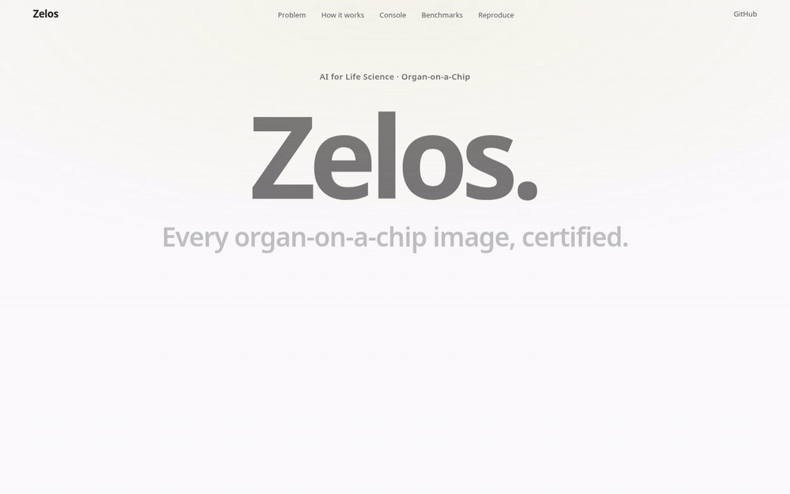

<div align="center">

# Zelos

### Every organ-on-a-chip image, certified.

An evidence-gated QC agent for in vitro organ-on-a-chip cultures. It finds the imaging fault, names the lab fix, cites open organ-on-a-chip research, and **blocks every claim the evidence cannot support.**

[](https://github.com/simon-derock/zelos/actions)


**[Live console](https://zelos.philipsimonderock.com)** · **[Demo video](https://youtu.be/bhoM2jl5zM4)** · [Results](results/results.md) · [Judges' map](JUDGES.md) · [Limitations](docs/LIMITATIONS.md)



<sub>AI4S Open Innovation: AI for Life Science · 5th Pazhou Algorithm Competition · <b>End-to-End System</b> · Built by Philip Simon Derock</sub>

</div>

---

## Measured, not claimed

| | |
|---|---|
| **100/100** | injected fabrications (fake numbers, fake citations, unsupported inferences) blocked by the grounding gate; 0 of 98 correct claims blocked |
| **0.067 → 0.000** | unsupported claims in LLM answers, without vs with the gate; valid citations 0.895 → 1.000; unsafe adversarial outputs 0.214 → 0.000 |
| **97.1%** | injected imaging faults flagged on real chip images (severity ≥3); the injected cause is named for 31.0% of them, against 11.1% by chance |
| **0.710 AUROC** | agreement with expert culture decisions using training-free kNN on the same physics features |
| **MRR 1.000** | Cohere + Qdrant + BM25 + rerank over 48 open organ-on-a-chip papers; declines 12/12 off-topic questions |
| **168 ms** | per image on a CPU. No GPU, no training, no paid service needed to reproduce |

All of these are regenerated by `evaluate.py`; CI fails if a number in this README is missing from [`results/results.md`](results/results.md). The honest failures are reported too: the pre-registered reference flags 76.7% of clean images from unseen sessions (acquisition shift; a batch reference lowers this to 46.7%), and the artifact score does not predict the expert label (AUROC 0.393), which tracks culture state instead.

## How it works

**The LLM proposes. Tools compute. The gate disposes.**

```
brightfield image ─► 17 physics QC metrics ─► robust z vs reference ─► cause + lab action ─► evidence retrieval ─► LLM explainer ─► grounding gate ─► certificate + claim ledger
                     0 LLM calls               0 LLM calls               0 LLM calls          Cohere · Qdrant · BM25    Workers AI        0 LLM calls
```

- **Vision QC:** focus, contrast, exposure, illumination, noise, debris, bubbles, compression, confluence. Classical image statistics, interpretable by design.
- **Cause → action:** a fixed rule table, e.g. bubble → "degas medium or flush the channel", defocus → "re-run autofocus".
- **Evidence:** hybrid retrieval with reciprocal rank fusion and Cohere `rerank-v3.5`, open-access CC BY papers only, with an abstain threshold.
- **Grounding gate:** every number must match a tool output, every citation must be a retrieved passage that supports the sentence, and every inference must rest on supported claims. Failing claims get one repair, then are blocked and logged.
- **Agent-native:** CLI (`zelos inspect | explain | triage | ask`), FastAPI, an **MCP server** and [`SKILL.md`](skills/zelos-qc/SKILL.md), so any MCP-capable agent can certify lab images.

## Quickstart

```bash
git clone https://github.com/simon-derock/zelos && cd zelos
make setup     # pinned deps
make judge     # tests + retrieval + grounding, replayed offline: no API keys needed
make data && make eval   # optional: 480 real images from Zenodo, regenerate every result
```

Live Cohere and Cloudflare Workers AI calls are optional (`.env.example`; both have free tiers). Every response used in the published results is committed and replayed.

## Data and licenses

| Resource | Use | License |
|---|---|---|
| Organ-on-a-Chip (OOC) Image Dataset, Movčana et al., *Data* 2024, Zenodo <!--np-->10.5281/zenodo.10203721<!--/np--> | evaluation: in vitro lung, intestinal and endothelial cell lines on chip, expert good/bad labels | CC BY 4.0 (the article lists CC BY-SA; derived thumbnails shared under CC BY-SA). Images are fetched by `data/download.py`, not redistributed. |
| 48 Europe PMC open-access papers | retrieval corpus (`corpus/manifest.csv`) | CC BY |
| Cohere `embed-v4.0`, `rerank-v3.5` · Workers AI `llama-3.1-8b-instruct-fast` | embeddings, reranking, explanations | provider terms; offline fallbacks included |

No patient, clinical or personal data. No model is trained or fine-tuned.

> Research tool. Not a medical device. No clinical or diagnostic claims.

Code: [MIT](LICENSE)
